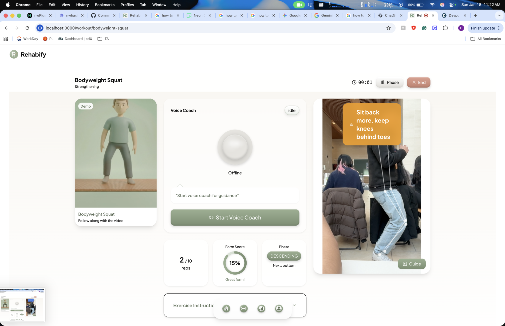
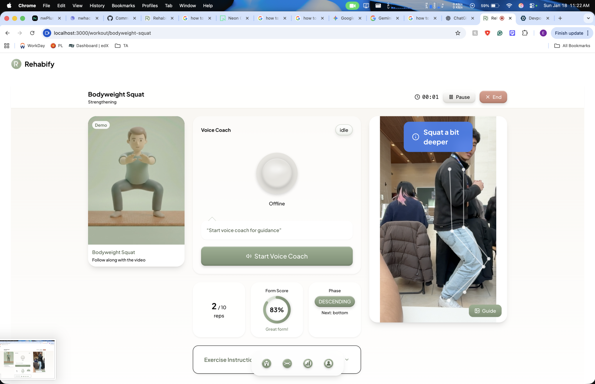
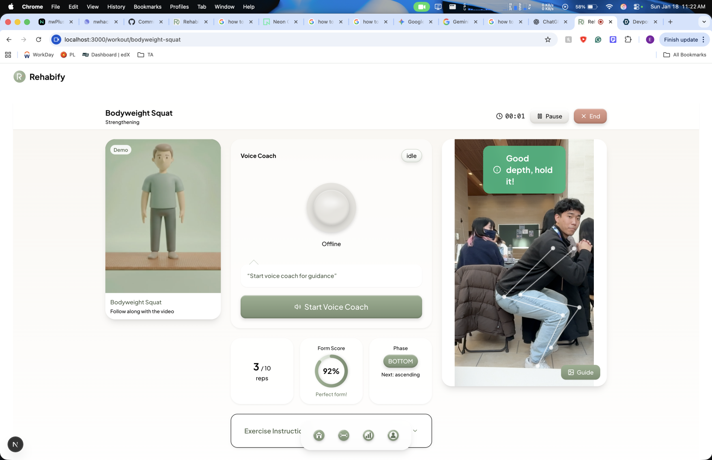
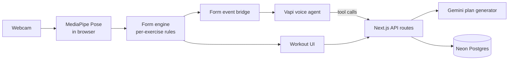

<div align="center">

# Rehabify

**A physical therapist in your living room: real-time form correction from your webcam, coached by voice.**

[](https://github.com/obro79/rehabify/actions/workflows/ci.yml)


🏆 **1st place, nwHacks 2026**

[Devpost](https://devpost.com/software/rehabify-y2f5mu) · [Architecture](docs/ARCHITECTURE.md) · [Run locally](#run-locally)

<!-- TODO(owen): add the live demo link here once the deployment URL is confirmed -->

</div>

<p align="center">
  
</p>

<!-- TODO(owen): record a 20 to 30 second GIF of the full flow (assessment, then a squat set with voice feedback) and swap it in above -->

| Poor form caught | Mid-rep coaching | Good form |
|:---:|:---:|:---:|
|  |  |  |
| *"Sit back more, keep knees behind toes"* | *"Squat a bit deeper"* | *"Good depth, hold it!"* |

## Why

Only about a third of physio patients finish their prescribed home exercises, and nobody checks
whether they are doing them right between visits. Rehabify started after $8K in physio bills and
appointments only every two weeks for a herniated disc: the clinic was not the broken part, the
time at home was.

## What it does

- **Watches your form in real time.** MediaPipe pose tracking runs in the browser and a rules
  engine counts and scores reps for 10 exercises, including squats, lunges, RDLs and lumbar
  flexion, extension and side bends. Video never leaves your device.
- **Coaches you by voice.** A Vapi voice agent corrects you mid-set ("keep your chest up") and
  answers questions, with debouncing so it does not nag.
- **Builds your plan.** A spoken intake assessment screens for red-flag symptoms, then Gemini
  generates a multi-week plan from a library of 200 exercises, with a rules-based fallback.
- **Keeps your physio in the loop.** A therapist portal shows each patient's adherence, form
  scores and pain trends, with messaging and plan editing.

## Architecture

The camera, pose model and form engine run entirely client-side at frame rate. Form errors
flow into the voice agent, which calls back into Next.js API routes for data. The server
handles auth, plan generation and persistence in Neon Postgres.



More detail, including how rep counting works, in [docs/ARCHITECTURE.md](docs/ARCHITECTURE.md).

## Tech stack

| Area | Tools |
|---|---|
| App | Next.js 16 (App Router), React 19, TypeScript, Tailwind CSS, Zustand |
| Computer vision | MediaPipe Pose Landmarker (WASM), One Euro filter, dynamic time warping |
| Voice | Vapi (Deepgram speech-to-text, LLM, ElevenLabs text-to-speech) |
| AI | Google Gemini for plan generation, validated with Zod |
| Data and auth | Neon Postgres, Drizzle ORM, Neon Auth |
| Tooling | Bun, Vitest, Testing Library, ESLint, GitHub Actions, Vercel |

## Run locally

**Prerequisites:** [Bun](https://bun.sh) 1.x, `psql`, a [Neon](https://neon.tech) Postgres database, and
API keys for [Vapi](https://dashboard.vapi.ai) and [Gemini](https://aistudio.google.com/apikey).

```bash
git clone https://github.com/obro79/rehabify.git
cd rehabify
bun install

cp .env.example .env.local   # then fill in the values below
bun run db:setup             # create tables and seed the exercise library
bun dev                      # http://localhost:3000
```

| Variable | Needed for |
|---|---|
| `DATABASE_URL`, `NEON_API_KEY` | Database |
| `NEON_AUTH_BASE_URL` | Sign-in (skipped in demo mode) |
| `NEXT_PUBLIC_VAPI_PUBLIC_KEY`, `VAPI_PRIVATE_KEY`, `VAPI_WEBHOOK_SECRET` | Voice coach |
| `GEMINI_API_KEY` | Plan generation |
| `NEXT_PUBLIC_APP_URL` | Links and callbacks |
| `NEXT_PUBLIC_DEMO_MODE` | Set to `true` to skip auth locally |

See [`.env.example`](.env.example) for the full list with notes.

## Tests

```bash
bun run test        # unit and component tests (Vitest)
bun run lint        # ESLint
bun run typecheck   # tsc --noEmit
```

The core suites cover rep counting and form rules in `src/lib/vision/__tests__`, the API
auth and validation helpers, and session persistence. CI runs all of the above plus a
production build on every pull request.

## Team

Built in 24 hours at nwHacks 2026 by:

- [Owen Fisher](https://github.com/obro79)
- [Eric Ding](https://github.com/EricDing05)
- [Jessica Zhou](https://github.com/jjcyz)
- [Andy Li](https://github.com/AndyJLi0)
