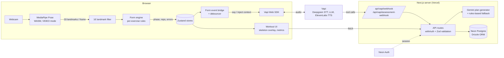
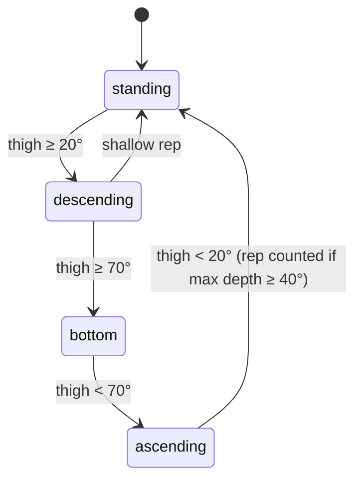

# Architecture

Rehabify is a single Next.js 16 app (App Router) deployed on Vercel. The camera
and the pose model run entirely in the browser; the server only sees derived
numbers (reps, form scores, pain reports), never video.

This document describes the system as it runs today. The longer-term design work
(multi-clinic data model, billing, HIPAA) lives in [`docs/redesign/`](redesign/README.md).

## System overview



## The real-time loop (browser)

Everything in this loop runs at camera frame rate, so none of it touches the network.

| Step | Code | What it does |
|---|---|---|
| Pose estimation | [`lib/vision/pose-landmarker.ts`](../src/lib/vision/pose-landmarker.ts), [`hooks/use-pose-detection.ts`](../src/hooks/use-pose-detection.ts) | Loads the MediaPipe Pose Landmarker (lite model, WASM) once and runs it on each video frame. |
| Smoothing | [`lib/vision/landmark-filter.ts`](../src/lib/vision/landmark-filter.ts) | A One Euro filter per landmark removes jitter without adding much lag. |
| Framing checks | [`lib/vision/camera-feedback.ts`](../src/lib/vision/camera-feedback.ts) | Tells the user to step back or into frame before form is judged. |
| Form analysis | [`lib/vision/form-engine.ts`](../src/lib/vision/form-engine.ts) | Picks the analyzer for the current exercise and keeps per-session state between frames. |
| Exercise rules | [`lib/vision/exercises/`](../src/lib/vision/exercises) | One pure function per exercise. Each turns landmarks into a phase (`standing`, `bottom`, ...), a rep signal, and form errors. |
| Shared math | [`lib/vision/geometry.ts`](../src/lib/vision/geometry.ts) | Joint angles (2D and 3D), midpoints, visibility-based confidence, and the side/front orientation check. |
| Rep quality | [`lib/vision/movement-comparison.ts`](../src/lib/vision/movement-comparison.ts) | Dynamic time warping compares a finished squat rep against a reference curve. |

### How an exercise analyzer works

Each analyzer is a small state machine driven by one or two angles. The squat, for example,
tracks the thigh angle from vertical:



Rep counting combines one engine-wide rule with analyzer-specific ones:

- **Warnings block reps (engine).** If the frame that completes a rep carries a warning-level
  error (bent knees, wrong orientation), the engine does not count the rep.
- **Hysteresis (some analyzers).** Several analyzers use different entry and exit thresholds so
  noise near a threshold cannot double count a rep. Lumbar flexion, for example, enters at a 90°
  hip angle and exits at 160°. Others, such as lumbar extension, use a single cutoff.

The squat and floor analyzers (cat-camel, cobra, dead bug) read overrides from
`detection_config.thresholds` in the exercise library and fall back to defaults in code. The
lumbar and standing analyzers (lunge, RDL) use fixed thresholds and ignore those overrides.

Supported analyzers: squat, Romanian deadlift, lunge, lunge with rotation, standing lumbar
flexion, extension and side bend, cat-camel, cobra and dead bug. Exercises without an analyzer
fall back to a pass-through that only reports visibility.

## Voice coaching

The voice coach is a Vapi assistant. The browser streams audio through the Vapi Web SDK, and
Vapi calls back into the app for anything that needs data.

- [`lib/voice/form-event-bridge.ts`](../src/lib/voice/form-event-bridge.ts) routes form errors to
  the voice. High-priority errors use `say()` and are spoken immediately; lower-priority ones are
  injected as context so the LLM can phrase them naturally.
- [`lib/voice/form-event-debouncer.ts`](../src/lib/voice/form-event-debouncer.ts) stops the
  coach from nagging: a 500 ms debounce, a 5 s cooldown per error type, and 10 s after three repeats.
- [`app/api/vapi/webhook`](../src/app/api/vapi/webhook/route.ts) serves workout tools
  (`get_form_status`, `get_exercise_info`, `log_pain_report`).
- [`app/api/vapi/assessment-webhook`](../src/app/api/vapi/assessment-webhook/route.ts) drives the
  intake assessment workflow, including red-flag detection that recommends in-person care
  before any exercise.

## Plan generation

After the assessment, [`lib/gemini/plan-generator.ts`](../src/lib/gemini/plan-generator.ts) asks
Gemini for a multi-week plan as JSON. The response is validated with Zod and every exercise slug
is matched (with fuzzy matching) against the exercise library, so the model cannot invent
exercises. If Gemini fails twice, [`fallback-plan.ts`](../src/lib/gemini/fallback-plan.ts) builds
a rules-based plan from the patient's directional preference.

## Server and data

- **API routes** live under [`src/app/api`](../src/app/api). Shared helpers in
  [`lib/api`](../src/lib/api) wrap handlers with auth (`withAuth`, role checks), Zod validation and
  a consistent JSON error shape.
- **Auth** is Neon Auth. [`src/proxy.ts`](../src/proxy.ts) protects app routes; demo mode
  (`NEXT_PUBLIC_DEMO_MODE=true`) skips it for judging and local development.
- **Database** is Neon serverless Postgres through Drizzle. Schemas are in
  [`src/db/schema`](../src/db/schema), SQL migrations and seed data in
  [`src/db/migrations`](../src/db/migrations).
- **Client state** uses Zustand stores in [`src/stores`](../src/stores). Workout sessions are
  persisted to local storage so a refresh can resume, and a `BroadcastChannel` guard
  ([`lib/session`](../src/lib/session)) stops two tabs from running the same session.

## Repository layout

```
src/
  app/            Routes: (auth), (dashboard), pt/ (therapist portal), api/
  components/     UI, grouped by feature (workout, assessment, pt, messaging, ...)
  db/             Drizzle schema and SQL migrations
  hooks/          Camera, pose detection, Vapi and session hooks
  lib/
    vision/       Pose pipeline and form engine (see above)
    voice/        Form-to-voice bridge
    vapi/         Vapi workflow config and webhook helpers
    gemini/       Plan generation
    api/          Route helpers: auth, validation, responses
  stores/         Zustand stores and selectors
docs/
  ARCHITECTURE.md This file
  redesign/       Forward-looking design docs
```

## Testing

Vitest with jsdom. The most important suites cover the parts that are easy to break and hard to
notice by hand:

- `src/lib/vision/__tests__`: rep counting, hysteresis, rep blocking and the geometry helpers,
  using synthetic side-on poses from `pose-fixtures.ts`.
- `src/lib/api/__tests__`: auth wrappers, validation and error responses.
- `src/lib/session/__tests__` and `src/stores/__tests__`: session persistence, the multi-tab
  guard and store behaviour.

CI ([`.github/workflows/ci.yml`](../.github/workflows/ci.yml)) runs lint, typecheck, tests and a
production build on every push and pull request.
